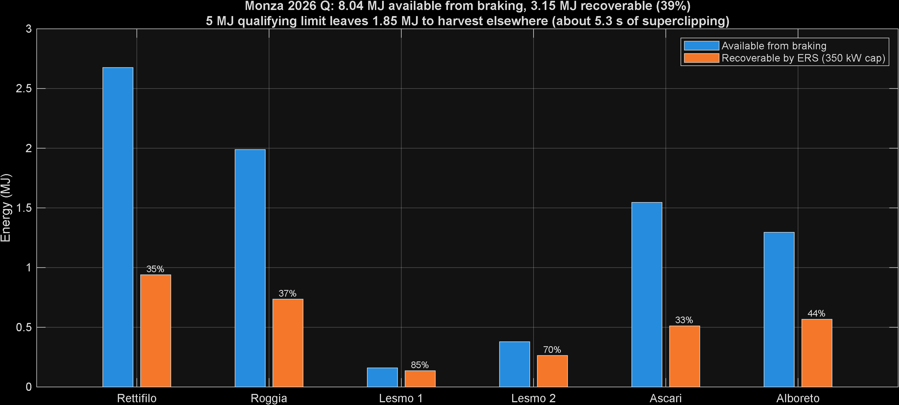
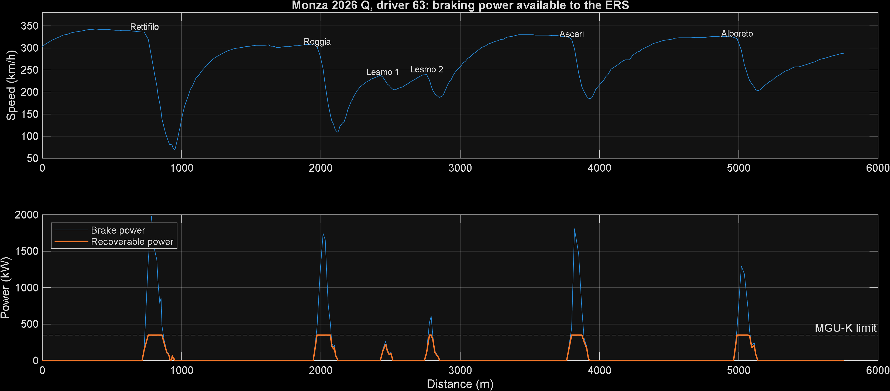

# F1 ERS Energy Analysis: Monza 2026 Qualifying

How much energy can an F1 car recover under braking on one lap of Monza, and is it enough to meet the 2026 energy limit?

This is Phase 1 of a personal project building a simplified F1-style hybrid energy management system: lap energy analysis, a deployment strategy in Stateflow and Simulink, a battery model with state-of-charge estimation, automated validation, and the strategy running on a microcontroller.

> **Simplified model, public data only.** Everything here comes from public timing data and published or reported regulation figures. Real ERS data is not public, so all car parameters are stated estimates. This project is not affiliated with Formula 1, the FIA, or any team.

## Key results

| | Value |
|---|---|
| Energy dissipated under braking per lap | **8.04 MJ** |
| Energy recoverable by the ERS (350 kW cap) | **3.15 MJ (39%)** |
| Monza 2026 qualifying recharge limit (reported) | 5 MJ |
| Shortfall to be harvested from braking | **1.85 MJ** |
| Equivalent superclipping time at 350 kW | at least 5.3 s per lap |

### Energy per braking zone

| Corner | Speed in → out (km/h) | Available (MJ) | Recoverable (MJ) | Share recovered |
|---|---|---|---|---|
| Rettifilo (T1 to T2) | 336 → 83 | 2.68 | 0.94 | 35% |
| Roggia (T4 to T5) | 303 → 114 | 1.99 | 0.74 | 37% |
| Lesmo 1 (T6) | 234 → 210 | 0.16 | 0.14 | 85% |
| Lesmo 2 (T7) | 240 → 196 | 0.38 | 0.26 | 70% |
| Ascari (T8 to T10) | 320 → 190 | 1.55 | 0.51 | 33% |
| Curva Alboreto, formerly Parabolica (T11) | 321 → 205 | 1.30 | 0.57 | 44% |

## Findings

1. **The MGU-K power limit, not efficiency, decides how much energy is recovered.** Peak braking power reaches 1.3 to 2.0 MW in the heavy zones, roughly five times the 350 kW the MGU-K can absorb.
2. **The heaviest braking zones recover the smallest share of their energy** (33 to 37%), because they spend most of their duration above the power cap. Light zones stay under the cap and only lose the assumed 15% efficiency (70 to 85% recovered).
3. **Braking alone cannot meet the 5 MJ qualifying limit at Monza.** About 1.85 MJ per lap must be harvested elsewhere, most likely by superclipping (the MGU-K harvesting engine power at full throttle near the end of straights). At the full 350 kW, that is at least 5.3 s per lap. At lower harvest power, it would take longer.
4. **This telemetry cannot show where that harvesting happens.** After removing smoothing and sampling artefacts, no sustained full-throttle deceleration remained before the braking zones. The only remaining case, near the exit of Curva Grande (about 1,650 m), could equally be cornering drag or an active aero mode change. Locating the harvesting is the job of the Phase 2 car model.

## Data

- **Source:** [OpenF1](https://github.com/br-g/openf1) public API, 2026 Italian Grand Prix qualifying.
- **Lap used:** car number 63, 1:21.846, the second-fastest lap of the session and the fastest with clean telemetry.
- **Channels:** speed (km/h, whole numbers), throttle (%), brake (on/off), gear, RPM, sampled at about 3.7 Hz.
- **Distance:** integrated from speed (trapezoidal rule). The result, 5,755 m, is 0.7% shorter than the official 5,793 m lap length, which is expected because the racing line cuts corners and coarse sampling slightly undercounts distance.
- **Why not FastF1:** From version 3.9, FastF1 needs an F1 TV Access subscription for most data, so this project uses OpenF1.

### Data quality checks

The ten fastest qualifying laps were checked automatically. Three were rejected, all from cars whose telemetry froze: speed held constant for several samples and then jumped, producing decelerations of 19 to 22 g. A lap is rejected if any of these hold:

| Rule | Reason |
|---|---|
| Throttle above 100% | Invalid-data marker in F1 live timing |
| Acceleration magnitude above 10 g | Physically impossible. Real peaks are about 5 to 6 g, and frozen data shows 19 g or more |
| Brake and throttle both on for 3 or more consecutive samples | Frozen data. A single sample is normal pedal crossover at this sample rate |
| Gap between samples above 1.5 s | Missing data |

## Method

For each sample:

- deceleration `a` from the speed trace (`gradient`)
- drag `F_drag = 0.5 · ρ · CdA · v²` and rolling resistance `F_roll = Crr · m · g`
- brake force `F_brake = max(−m·a − F_drag − F_roll, 0)`, the part of the slowing force the brakes provide, which is the only part an ERS can recover
- brake power `P_brake = F_brake · v`
- recoverable power `P_rec = min(η · P_brake, P_max)`

Braking zones are where brake power exceeds 50 kW. Zones separated by 3 samples or fewer are merged. Energy per zone is the time integral of power (`trapz`).

## Assumptions

| Parameter | Value | Basis |
|---|---|---|
| Car mass | 780 kg | 768 kg 2026 minimum (with driver, without fuel) plus an estimated qualifying fuel load |
| Air density ρ | 1.2 kg/m³ | Standard conditions |
| Drag area CdA | 1.0 m² | Estimate for a low-drag Monza setup |
| Rolling resistance Crr | 0.015 | Estimate |
| Recovery efficiency η | 0.85 | Estimate for MGU-K plus inverter |
| MGU-K harvest limit P_max | 350 kW | 2026 power unit regulations |
| Recharge limit | 5 MJ per lap | Monza 2026 qualifying limit, as reported in September 2026 |

Regulation figures are taken from published summaries and press reports rather than the current FIA regulations document, and should be checked against it.

## Limitations

- **Sample rate.** At about 3.7 Hz, there are only 5 to 8 samples per braking zone, so peak deceleration is smoothed out. Braking energy is therefore slightly **underestimated**, a conservative error.
- **Speed resolution.** Speed is reported in whole km/h, which adds noise of about 1 m/s² to calculated acceleration.
- **Constant drag.** CdA is held constant, but 2026 cars use active aerodynamics that change drag between straights and corners.
- **Brake channel.** Brake is on/off only, so braking power comes from deceleration, not brake pressure.
- **Recovery is per-axle in reality.** The MGU-K acts on the rear axle only, and brake balance limits how much braking it can take. This is not modelled.
- **One lap, one session.**

## Files

| File | Purpose |
|---|---|
| `get_lap_openf1.py` | Downloads the qualifying session, checks the ten fastest laps for data quality, exports the fastest clean lap to CSV |
| `Monza_2026_Q_clean.csv` | The clean lap: time, distance, speed, throttle, brake, gear, RPM |
| `energy_analysis.m` | Braking power, energy per zone, shortfall against the limit, figures, and the full-throttle deceleration test |
| `figures/` | Exported figures |

## How to run

1. Python with `numpy`, `pandas`, and `requests` (Anaconda works): `python get_lap_openf1.py`
2. MATLAB R2026a (base MATLAB only): run `energy_analysis.m` in the same folder.

## Next: Phase 2

A point-mass car model in Simulink with a Stateflow deployment strategy (harvest, deploy, neutral, fault-safe), comparing strategies on lap time against energy used, and testing where the missing 1.85 MJ can be harvested.

---

*Fares Mahgoub, BEng Mechatronics and Autonomous Systems, Liverpool John Moores University. November 2026.*
